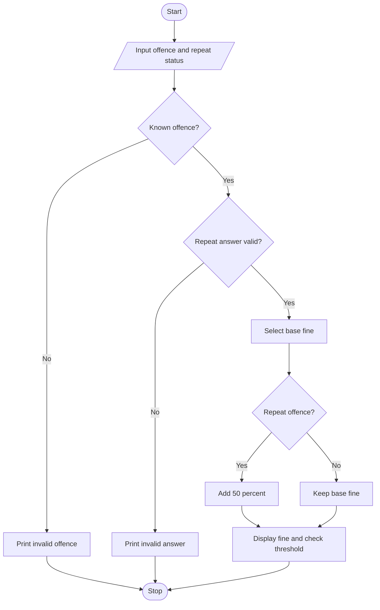

# Case Study 21: Traffic Violation Penalty Calculator

## Problem statement
Calculate a hypothetical fine according to offence type and repeat-offence status, and show a warning when the fine reaches a threshold.

## Objectives
- Select a fine using if-elif-else.
- Apply an additional amount for repeat offences.
- Use a condition to show a review warning.

## Assumptions
- Sample base fines: helmet Rs. 500, signal Rs. 1,000, speeding Rs. 1,500.
- A repeat offence adds 50% of the base fine.
- Fine of Rs. 1,500 or more is flagged for review.
- These are educational example values, not current legal penalties.

## Algorithm
1. Input offence and repeat status.
2. Select base fine.
3. Validate the offence and repeat answer.
4. Add 50% if it is a repeat offence.
5. Display fine and threshold warning if applicable.

## Flowchart


## Pseudocode
```text
BEGIN
INPUT offence, repeat
Select base fine using offence
IF offence invalid: print error
ELSE IF repeat not yes/no: print error
ELSE
    IF repeat = yes: fine = fine + fine * 0.50
    print fine
    IF fine >= 1500: print review warning
END
```

## Test cases
| Offence | Repeat? | Expected result |
|---|---|---|
| helmet | no | Fine Rs. 500 |
| signal | yes | Fine Rs. 1,500 and review warning |
| speeding | yes | Fine Rs. 2,250 and review warning |

## Output screenshot
Run `main.py` and capture the terminal output.

## Conclusion
This program demonstrates conditions, arithmetic, and input validation using a hypothetical penalty policy. Check current local laws for real fines.
