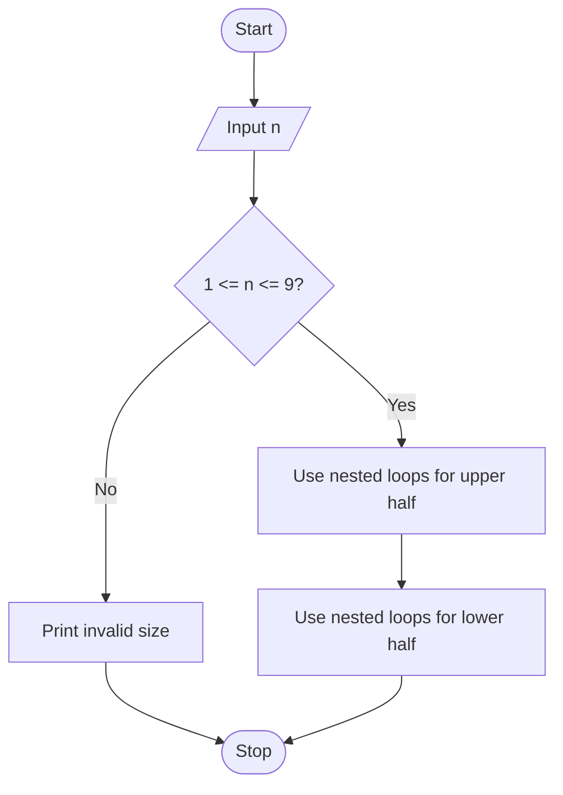

# Case Study 27: Advanced Numeric Pattern Generator

## Problem statement
Print a centered symmetric numeric diamond using a user-specified size and reject invalid sizes.

## Objectives
- Practise nested loops and `range()`.
- Generate aligned numeric patterns.
- Validate the size before printing.

## Assumptions
- Size must be an integer from 1 to 9.
- Each row increases to its row number and then decreases symmetrically.

## Algorithm
1. Read the pattern size.
2. If it is outside 1–9, print an error.
3. Use nested loops to print the upper half.
4. Use nested loops to print the lower half.
5. Stop.

## Flowchart


## Pseudocode
```text
BEGIN
INPUT n
IF n < 1 OR n > 9
    PRINT invalid size
ELSE
    FOR i from 1 to n
        PRINT leading spaces
        PRINT numbers from 1 to i
        PRINT numbers from i-1 down to 1
    FOR i from n-1 down to 1
        PRINT the same symmetric row
END IF
END
```

## Test cases
| Input size | Expected output |
|---:|---|
| 3 | `  1`, ` 121`, `12321`, ` 121`, `  1` |
| 1 | `1` |
| 0 | Invalid size message |

## Output screenshot
Run `main.py` with size 3 and capture the terminal output.

## Conclusion
This program demonstrates nested loops, string repetition, conditions, and pattern generation.
