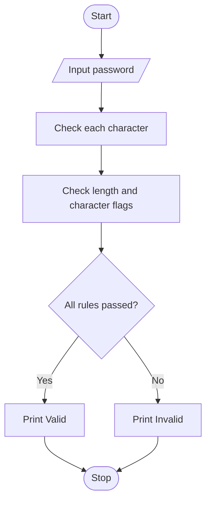

# Case Study 29: Password Policy Validation Engine

## Problem statement
Check a sample password against basic rules: at least 8 characters, one uppercase letter, one lowercase letter, and one digit.

## Objectives
- Examine characters in a string.
- Use Boolean variables and a loop.
- Report each requirement and the final status.

## Assumptions
- Minimum length is 8.
- Uppercase, lowercase, and digit are all required.
- This educational program does not store passwords.

## Algorithm
1. Read a sample password.
2. Set uppercase, lowercase, and digit flags to false.
3. Check each character and update the flags.
4. Check password length.
5. Display each rule and the final result.

## Flowchart


## Pseudocode
```text
BEGIN
INPUT password
upper = false; lower = false; digit = false
FOR each character ch in password
    IF ch is uppercase: upper = true
    IF ch is lowercase: lower = true
    IF ch is digit: digit = true
length_ok = length(password) >= 8
PRINT each requirement
IF length_ok AND upper AND lower AND digit
    PRINT Valid
ELSE
    PRINT Invalid
END IF
END
```

## Test cases
| Password | Expected result |
|---|---|
| `Study2026` | All rules true; Valid |
| `hello` | Length, uppercase, digit fail; Invalid |
| `PASSWORD9` | Lowercase requirement fails; Invalid |

## Output screenshot
Run `main.py` and capture the terminal output for a valid and invalid password.

## Conclusion
This program uses strings, loops, Boolean variables, and conditional statements.
