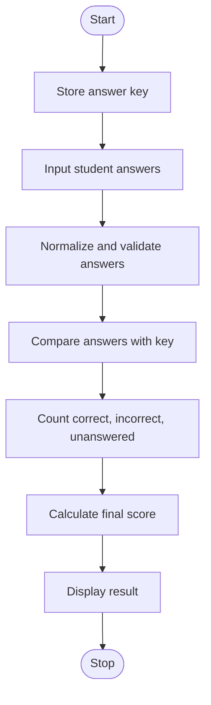

# Case Study 31: String-Based Examination Answer Evaluation

## 1. Problem Statement
Write a Python program that compares a student's answers with a given answer key, counts correct, incorrect, and unanswered questions, applies negative marking for incorrect answers, and displays the final score.

## 2. Objectives
- Practise strings, lists, loops, conditional statements, and arithmetic operators.
- Calculate a score using a simple marking scheme.
- Validate and summarize student responses.

## 3. Assumptions
- There are five multiple-choice questions.
- Each correct answer earns 2 marks.
- Each incorrect answer loses 0.5 marks.
- An unanswered question earns 0 marks.
- Enter X for an unanswered question.
- Answers are case-insensitive; spaces around answers are ignored.

## 4. Algorithm
1. Start.
2. Store the answer key in a list.
3. Read the student's answer for each question.
4. Convert each answer to uppercase and remove surrounding spaces.
5. Validate that each answer is A, B, C, D, or X.
6. Count correct, incorrect, and unanswered responses.
7. Calculate the score using the marking scheme.
8. Display the counts and final score.
9. Stop.

## 5. Flowchart


## 6. Pseudocode
```text
START
  answer_key = [A, C, B, D, A]
  correct = 0
  incorrect = 0
  unanswered = 0

  FOR each question from 1 to 5
    INPUT answer
    CONVERT answer to uppercase and trim spaces
    WHILE answer is not A, B, C, D, or X
      DISPLAY invalid input
      INPUT answer again
    IF answer is X
      unanswered = unanswered + 1
    ELSE IF answer equals answer_key for this question
      correct = correct + 1
    ELSE
      incorrect = incorrect + 1

  score = correct * 2 - incorrect * 0.5
  DISPLAY counts and score
STOP
```

## 7. Python Source Code
See `main.py`.

## 8. Test Cases

| Test | Student answers | Correct | Incorrect | Unanswered | Score |
|---|---|---:|---:|---:|---:|
| 1 | A, C, B, D, A | 5 | 0 | 0 | 10.0 |
| 2 | A, B, X, D, C | 2 | 2 | 1 | 3.0 |
| 3 | X, X, X, X, X | 0 | 0 | 5 | 0.0 |
| 4 | B, D, A, C, B | 0 | 5 | 0 | -2.5 |

## 9. Sample Output
```text
Enter answer for question 1 (A/B/C/D, or X if blank): A
Enter answer for question 2 (A/B/C/D, or X if blank): C
Enter answer for question 3 (A/B/C/D, or X if blank): B
Enter answer for question 4 (A/B/C/D, or X if blank): D
Enter answer for question 5 (A/B/C/D, or X if blank): A

----- Examination Result -----
Correct answers: 5
Incorrect answers: 0
Unanswered questions: 0
Final score: 10.0 out of 10
```

## 10. Conclusion
The program evaluates multiple-choice answers using strings, lists, loops, conditions, and arithmetic. It provides a clear summary and calculates the score using negative marking.
