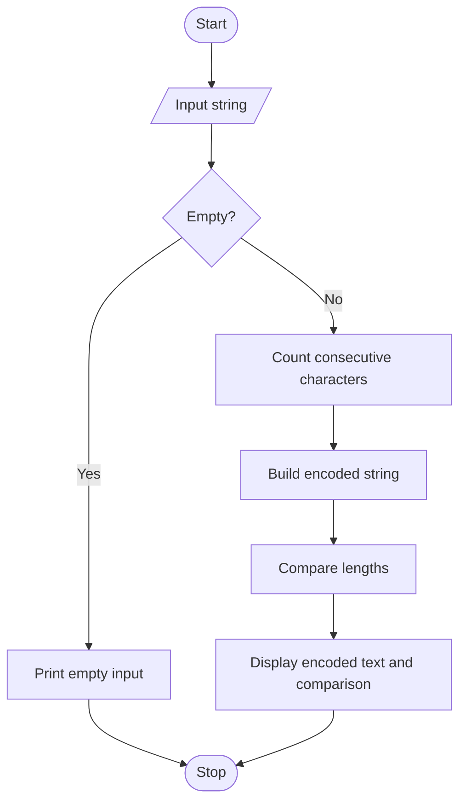

# Case Study 35: Text Compression Using Character Runs

## Problem statement
Encode consecutive repeated characters as the character followed by its count, then compare the original and encoded lengths.

## Objectives
- Traverse a string with a loop.
- Count repeated adjacent characters.
- Compare lengths using conditions.

## Assumptions
- Input is a non-empty string for normal processing.
- Each run is written as character plus count, including count 1.
- This is a simple classroom encoding, not a universal compression method.

## Algorithm
1. Read a string.
2. Handle empty input.
3. Start a count at one.
4. Loop through the string and count adjacent repeated characters.
5. When a character changes, append the previous character and count.
6. Append the last run and compare lengths.

## Flowchart


## Pseudocode
```text
BEGIN
INPUT text
IF text is empty
    PRINT Empty input
ELSE
    encoded = empty string
    count = 1
    FOR i from 1 to length(text)-1
        IF text[i] equals text[i-1]
            count = count + 1
        ELSE
            append text[i-1] and count to encoded
            count = 1
    append final character and count
    PRINT encoded and both lengths
END IF
END
```

## Test cases
| Input | Expected output |
|---|---|
| `aaaaa` | Encoded `a5`; original length 5; encoded length 2; shorter |
| `abc` | Encoded `a1b1c1`; original length 3; encoded length 6; not shorter |
| `aaabbc` | Encoded `a3b2c1`; original length 6; encoded length 6; not shorter |

## Output screenshot
Run `main.py` with `aaaaa` and capture the terminal output.


## Conclusion
This program demonstrates string processing, loops, counting, concatenation, and length comparison.
