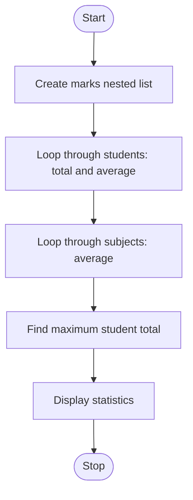

# Case Study 42: Student Marks Matrix Analysis

## Problem statement
to analyze the marks of three students in three subjects. This program is calculateing the total marks and average marks of each student, calculate the average marks obtained in each subject, and identify the student who scored the highest total marks. Display all the results clearly using appropriate loops, lists, and conditional statements.

## Objectives
1.To calculate the total marks and average marks obtained by each student in three subjects.

2.To calculate the average marks obtained by all three students in each subject.

3.To identify the student who scored the highest total marks.

4.To understand the use of lists, nested lists, for loops, conditional statements, and the append() method in Python.


5.To display the results clearly using formatted output.

## Assumptions
- The example contains 3 students and 3 subjects.
- Marks are integers from 0 to 100.
- If totals tie, the first student with the highest total is selected.

## Algorithm
1. Create a nested list of marks.
2. For each student row, calculate total and average.
3. For each subject column, calculate the average.
4. Find the highest student total.
5. Display all summaries.

## Flowchart


## Pseudocode
```text
BEGIN
marks = nested list of student marks
FOR each student row
    calculate total and average
    store total
FOR each subject column
    add marks for all students
    calculate and print subject average
find index of maximum total
print top student and highest total
END
```

## Test cases
| Test input / condition | Expected result |
|---|---|
| Included matrix | Totals: 255, 229, 270; top student is Student 3 |
| A student's marks are 100, 100, 100 | Total 300; average 100.00 |
| A student's marks are 0, 0, 0 | Total 0; average 0.00 |

## Output screenshot
Run `main.py`; capture the displayed student and subject summaries.


## Conclusion
This program practises nested lists, nested loops, arithmetic, and finding maximum values.
