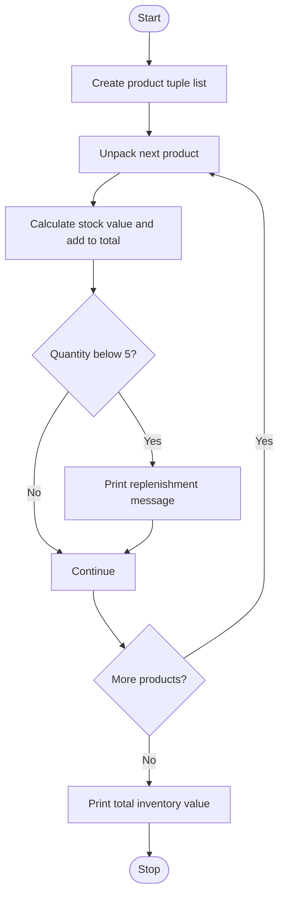

# Case Study 49: Tuple-Based Product Catalogue Audit

## Problem statement
Store product ID, name, price, and quantity in tuples. Calculate stock values and identify products requiring replenishment.

## Objectives
- Store fixed product records using tuples.
- Use tuple unpacking to access fields.
- Calculate inventory value and detect low stock.

## Assumptions
- Each tuple is `(ID, name, price, quantity)`.
- Replenishment is required when quantity is below 5.
- The catalogue contains sample data for practice.

## Algorithm
1. Create a list of product tuples.
2. Unpack each tuple into variables.
3. Calculate price multiplied by quantity.
4. Add each stock value to the total.
5. Display a replenishment message if quantity is below 5.
6. Display total inventory value.

## Flowchart


## Pseudocode
```text
BEGIN
products = list of product tuples
total_value = 0
FOR each product
    unpack id, name, price, quantity
    value = price * quantity
    total_value = total_value + value
    print product value
    IF quantity < 5 print replenishment required
PRINT total_value
END
```

## Test cases
| Product condition | Expected result |
|---|---|
| Notebook: price 40, quantity 12 | Stock value Rs. 480; no warning |
| Pen: price 10, quantity 3 | Stock value Rs. 30; replenishment required |
| Product quantity 0 | Stock value Rs. 0; replenishment required |

## Output screenshot
Run `main.py` and capture the inventory summary.


## Conclusion
This program uses tuples, tuple unpacking, lists, loops, and conditions for a simple stock audit.
